# 검증 결과 (2026-11-10, 0.4.0)

## 실행한 명령
```
npm test                                   # 21/21 통과
npm run check                              # 구문 검사 통과
NODE_PATH=$(npm root -g) npm run e2e        # 73/73 통과 (Chromium, Playwright)
```
GitHub Pages 하위 경로(`/public-assets/`)에서 서비스워커 scope·파일 로드 오류 없음도 별도로 확인.

## 브라우저 종단 테스트 출력 (합성 데이터)
```
1. 모바일 390px: 등록·다제품·사진·리로드
  ✓ 첫 화면 가로 넘침 없음 (390)
  ✓ QR 사진부터 임시 이름 업체 생성
  ✓ QR 사진이 친구추가/OCR로 표시되지 않음
  ✓ 완료·다음 업체로 새 업체 생성
  ✓ 미스트+진정 → 미스트·진정 질문 표시
  ✓ 선크림 해제 → SPF 질문 숨김
  ✓ 진정 해제 → 질문 숨김
  ✓ 진정 다시 선택 → 기존 답변 유지
  ✓ 답변 버튼 재탭 시 미확인으로
  ✓ 깨진 파일은 정확한 실패 안내
  ✓ 제품별 사진 연결 분리
  ✓ 제품별 답변/가격 분리
  ✓ 사진 1800px JPEG 압축
  ✓ 편집 화면 가로 넘침 없음 (390)
  ✓ 확대보기에서 원본 크기(압축본 1800px) 로드
  ✓ 리로드 후 업체 2개 유지
  ✓ 리로드 후 사진 메모/중요 유지
  ✓ 리로드 후 사진 미리보기 표시
  ✓ 중국어 UI 전환 (답변/증빙 버튼 포함)
  ✓ 중국어 문의 복사 (미응답 질문)
1b. 용기·패키지 업체 · 신뢰 확인
  ✓ 용기 업체 등록 → 업종·제품 구분 자동 설정
  ✓ 용기 제품은 효능 대신 소재, 화장품 질문 없음
  ✓ 에어리스 선택 → 에어리스 질문
  ✓ 신뢰 확인: 용기 업체에는 생산허가증 항목 없음
  ✓ 신뢰 확인 기록 후 펼친 상태 유지
  ✓ 신뢰 확인·위험 신호·판단 근거 저장
  ✓ 신뢰 확인 화면 가로 넘침 없음 (390)
  ✓ 용기·신뢰 확인 중국어 표시
  ✓ 용기 중국어 문의 복사 (미응답만)
2. 저장 실패 처리
  ✓ 저장 실패 시 다음 업체로 이동 안 함
  ✓ 저장 실패 경고줄 + 저장공간 안내
  ✓ 실패 알림 표시
  ✓ [다시 저장] 성공 시 경고 해제
3. 사진 포함 백업 → 새 브라우저 복원
  ✓ 백업 파일: schemaVersion 1, 사진 data 포함
  ✓ 복원/합치기: B 기록 유지 + A 기록 추가
  ✓ 복원 후 답변 대조 일치
  ✓ 복원 후 사진 표시
  ✓ 편집 화면 가로 넘침 없음 (1440)
  ✓ 같은 백업 재가져오기 → 중복 없음
3b. 두 기기 동기화
  ✓ 예전 파일 재수신 → 내 최신 수정 유지, 사본 없음
  ✓ 동시 수정 → 내 기록 유지 + 상대 버전은 사본
4. 비교표·CSV
  ✓ 비교표: 제품 단위 행
  ✓ 필터: 업종=용기·패키지
  ✓ 필터: 위험 신호 없는 업체만
  ✓ 필터: 제품 종류=크림
  ✓ 질문 열 추가 (진정 시험자료)
  ✓ 비교표 가로 넘침 없음 (1440)
  ✓ CSV: BOM·한글·중국어 정상
  ✓ CSV: 수식 문자 무력화
  ✓ 비교표 가로 넘침 없음 (390, 카드형)
5. 사진 삭제·미연결 사진함
  ✓ 사진 삭제 전 확인창
  ✓ 미연결 사진을 업체에 연결
5b. 업체 삭제·휴지통·삭제 동기화
  ✓ 선택 삭제: 선택 수 표시
  ✓ 선택 삭제 확인창 + 목록에서 빠짐
  ✓ 휴지통에서 복원
  ✓ 편집 화면 상단 [삭제] → 휴지통
  ✓ 휴지통 업체는 비교표에서 제외
  ✓ B→A: B가 지운 업체가 A에서도 휴지통으로
  ✓ B→A: B가 등록한 업체 추가
  ✓ B→A: 동시 수정은 사본, 내 기록 유지, 되돌아온 내 사본은 생략
  ✓ 휴지통 비우기 → 영구 삭제(동기화용 표시만 남음)
6. 0.1 데이터 보존 이관
  ✓ DB v2 이관
  ✓ 이관 전 원본 보관 (backup-before-v2)
  ✓ 이관 후 메타에는 사진 데이터 없음, 사진 저장소로 이동
  ✓ 이관 후 답변/메모 유지
  ✓ 이관된 사진 미리보기 표시(썸네일 자동 생성)
7. PWA 오프라인 실행
  ✓ 상태 화면: 오프라인 준비됨
  ✓ manifest: standalone + 아이콘 192/512
  ✓ 서버 종료 상태에서 앱 시작(캐시)
  ✓ 오프라인 입력 후 재실행해도 유지
  ✓ 서버 재연결 후 기록 유지
8. 새 버전 업데이트 안내
  ✓ 새 버전 설치 후 [지금 적용] 안내 표시 (자동 교체 안 함)
  ✓ 적용 후 새 캐시로 교체, 기록 유지

결과: 73 통과, 0 실패
```

## 화면 (합성 데이터)
| 390px 목록 | 390px 업체 확인 | 390px 질문 | 390px 中文 |
|---|---|---|---|
| 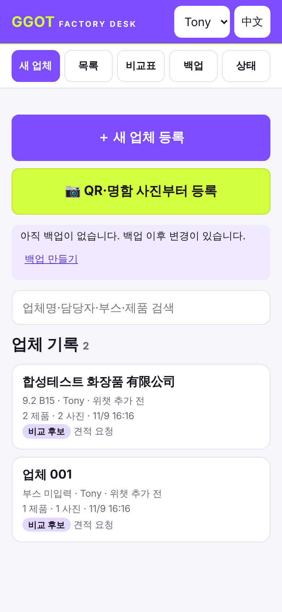 | 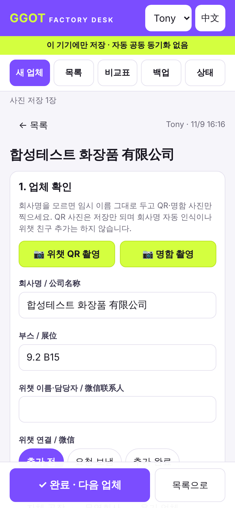 | 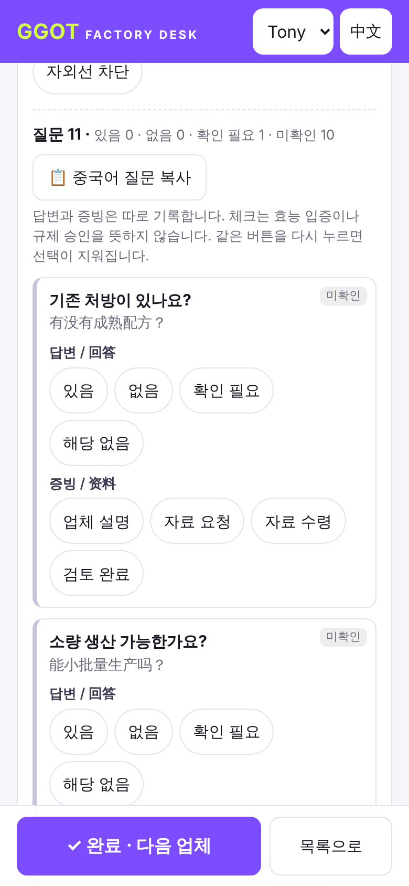 | 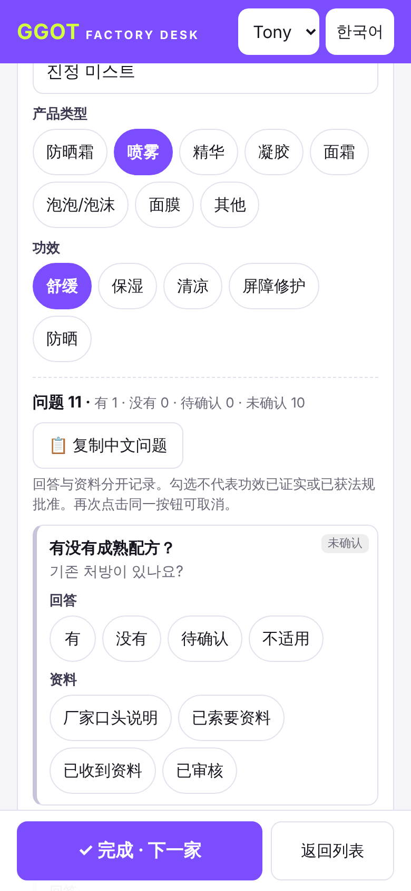 |

| 390px 비교(카드) | 저장 실패 경고 | 상태 화면 |
|---|---|---|
| 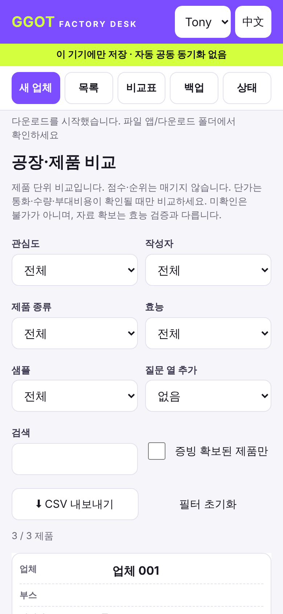 | 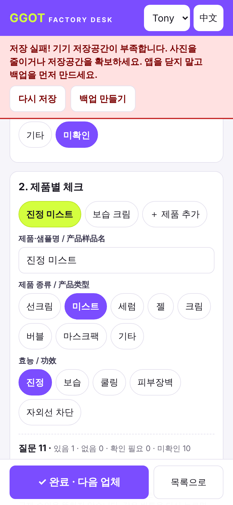 | 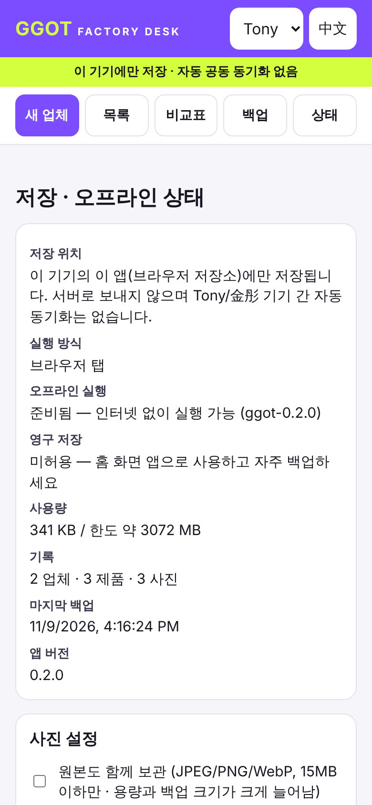 |

| 용기·패키지 업체 | 신뢰 확인 | 선택 삭제 |
|---|---|---|
| 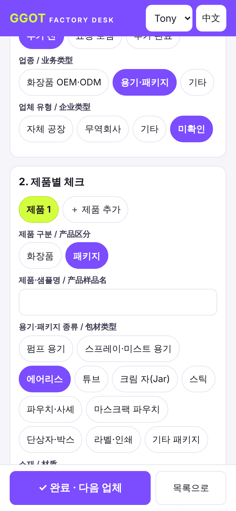 | 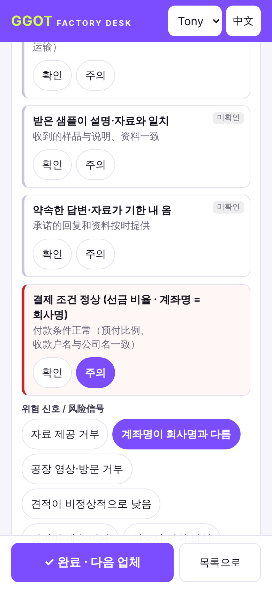 | 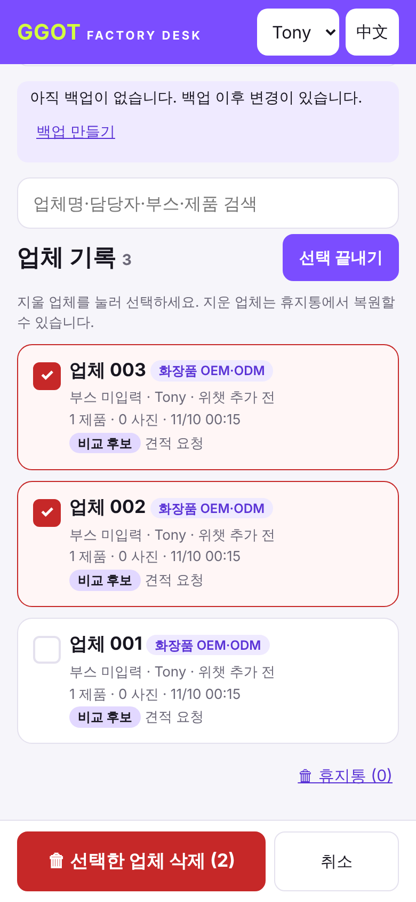 |

1440px 비교표: 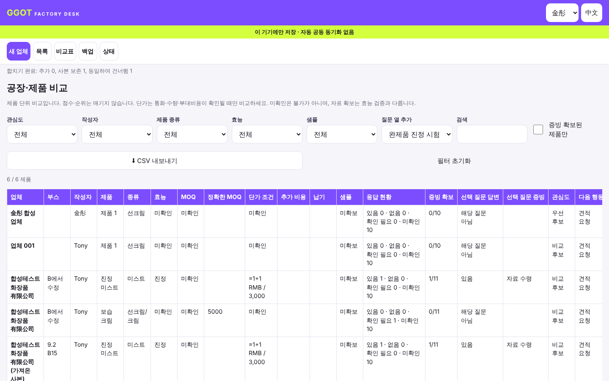

## 미검증 (실기기 필요)
- 아이폰 Safari/홈 화면 앱: 카메라 촬영(capture), 앨범 HEIC 선택, 공유 시트 "파일에 저장", AirDrop, 비행기 모드 재실행
- 아이폰 실제 저장공간 한도·장시간(수백 장) 사용 시 속도
- Windows Edge/Chrome 실제 다운로드 폴더, Excel에서 CSV 열기
- 중국 본토/홍콩에서 배포 주소 접속 (측정 안 함 — 출국 전 설치 전제)
- iOS가 홈 화면 앱 저장소를 장기간 미사용 시 정리하는지 여부 (영구 저장 요청은 구현, 허용 여부는 상태 화면에서 확인)

## 미구현 (의도적으로 미룸)
- 서버를 통한 자동(실시간) 동기화·로그인 (CLAUDE.md "후속 공동관리"). 0.4는 AirDrop 등 파일 교환 동기화만 지원
- 아이폰 두 대 사이 AirDrop 실제 전달 (실기기 필요)
- 담당자 여러 명·정식 견적·샘플 테이블 (SPEC P3)
- 질문별 개별 메모/사진 연결, OCR, 공장 순위·규제 판정
